<p align="center">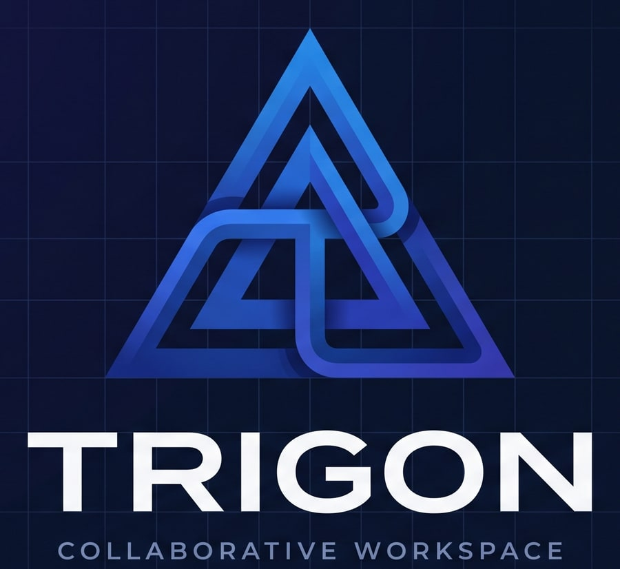</p>

<h3 align="center">The self-hosted knowledge base for IT teams — runbooks people can trust.</h3>

<p align="center">
  Real-time editing like Notion · verification and review built in · Microsoft Entra ID &amp; Active Directory · a full audit trail · runs on your own NAS.
</p>

<p align="center">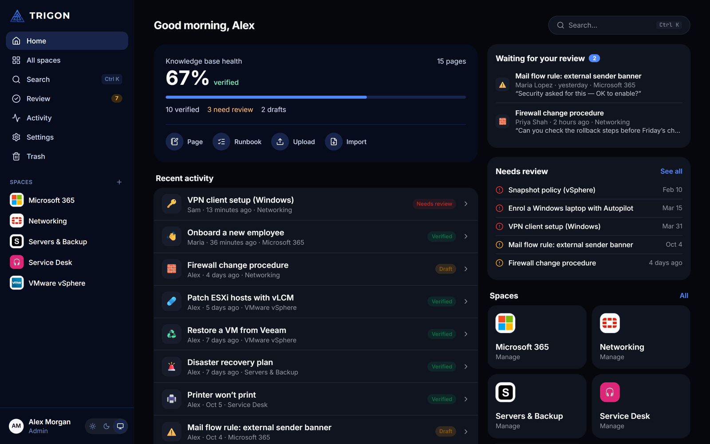</p>

## See it live

<p align="center">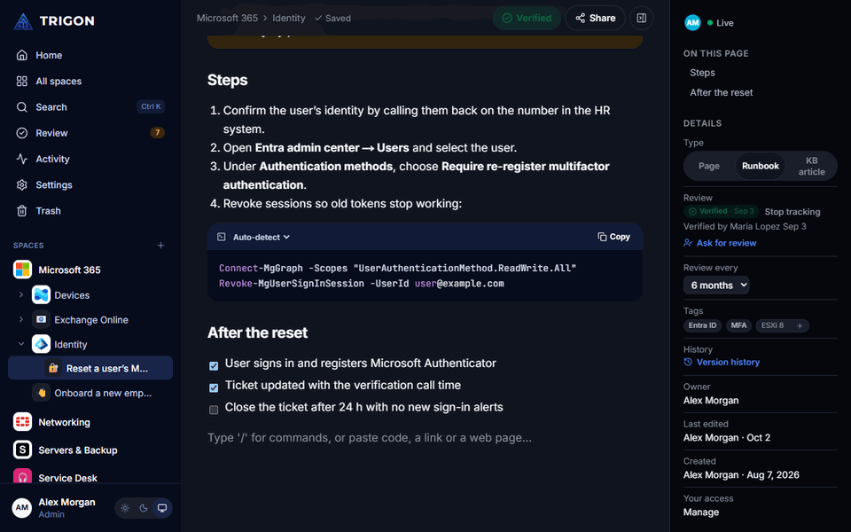</p>
<p align="center"><sub>Alex has the runbook open while Maria adds a step from her own laptop — her cursor and text appear instantly.</sub></p>

## What makes Trigon different

**Knowledge you can trust.** Every page is *Verified*, *Needs review* (its review interval passed) or a *Draft*. Ask a colleague to review a page — they get an email, see it on their home page, and approve it or request changes. The home screen shows how much of your knowledge base is still trustworthy.

**Made for runbooks.** Pages are *Runbooks*, *KB articles* or plain pages, with checklists, callouts, highlighted code blocks (PowerShell, Bash, YAML… detected automatically on paste) and tags like `ESXi 8`. Spaces and folders carry the real vendor logos — Microsoft, VMware, Fortinet, Synology and 130+ more.

**Every change is accountable.** The Activity explorer records who created, edited, moved, deleted, shared or signed in — with the exact lines that changed, the IP address and the device, filters and CSV export. Every page keeps its version history; deleted items wait in the trash for 30 days.

**Your directory, your server.** One click connects Microsoft Entra ID (Trigon registers its own app in your tenant), or sign in with LDAP / Active Directory; users and groups sync on a schedule and drive permissions. It all runs in Docker on your NAS, with scheduled backups to the same server, an SMB share or NFS — and restore straight from the list.

<table>
  <tr>
    <td width="50%">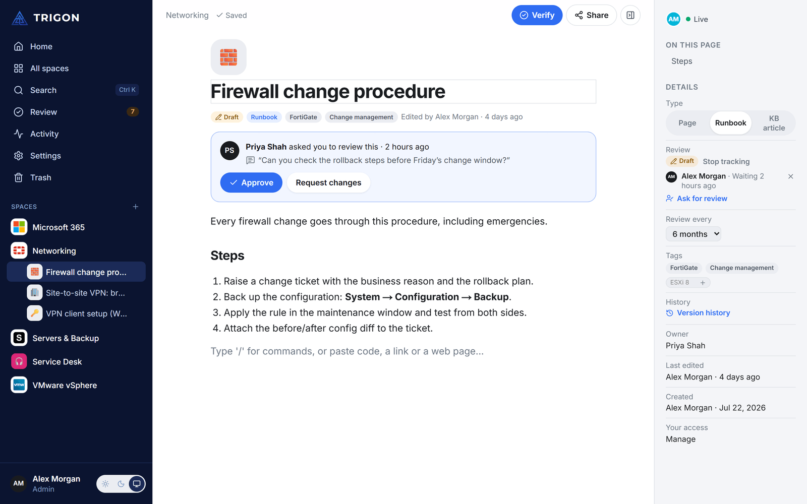<br><b>Review requests</b> — approve or request changes right on the page.</td>
    <td width="50%">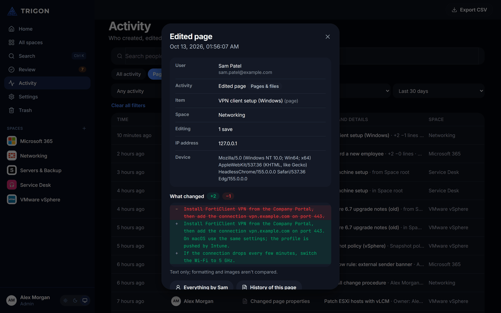<br><b>Activity explorer</b> — who changed what, down to the line.</td>
  </tr>
  <tr>
    <td>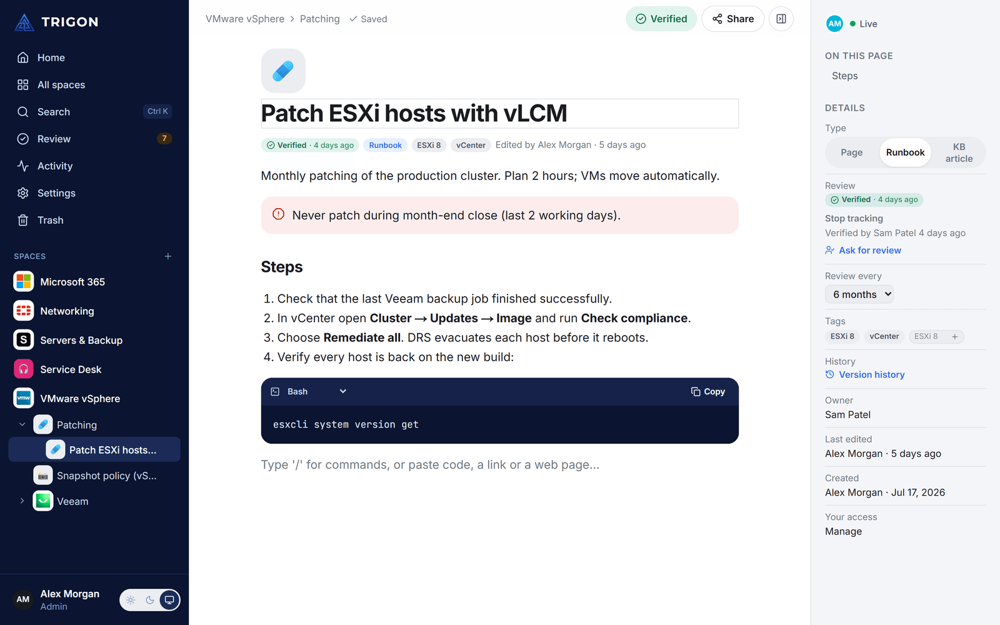<br><b>Runbooks</b> — verified status, tags, owner and review interval.</td>
    <td>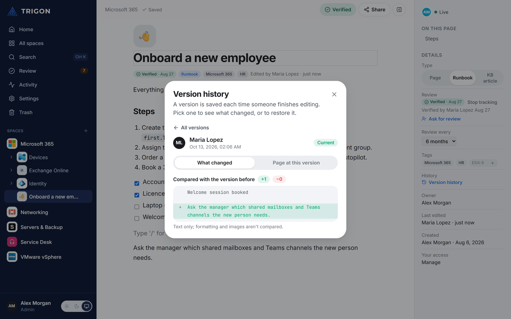<br><b>Version history</b> — see each editing session and restore it.</td>
  </tr>
  <tr>
    <td>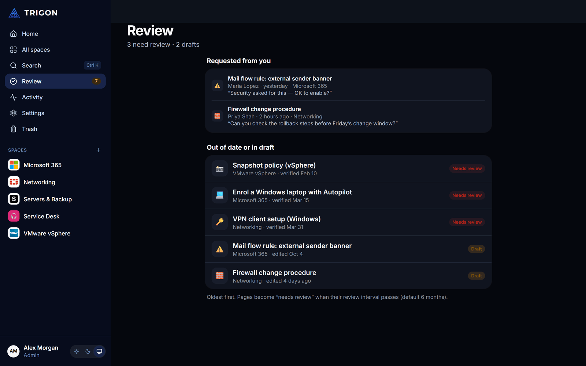<br><b>Review list</b> — what was asked of you, and what is out of date.</td>
    <td>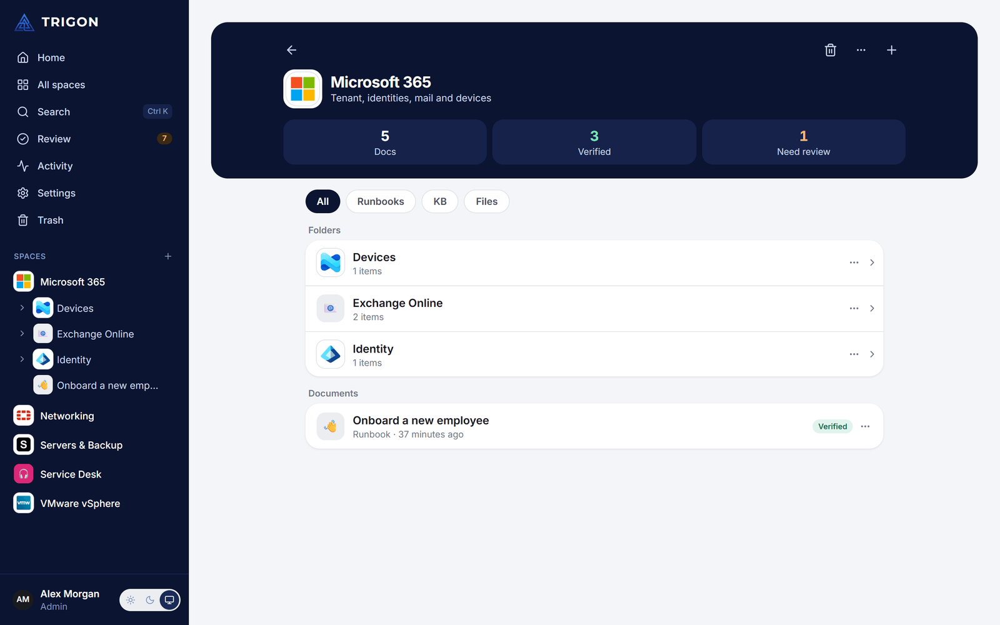<br><b>Spaces</b> — folders, runbooks, KB articles and files.</td>
  </tr>
  <tr>
    <td>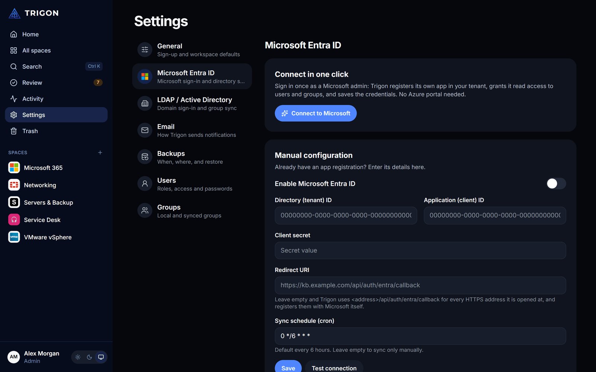<br><b>Microsoft Entra ID</b> — connect in one click, no Azure portal.</td>
    <td>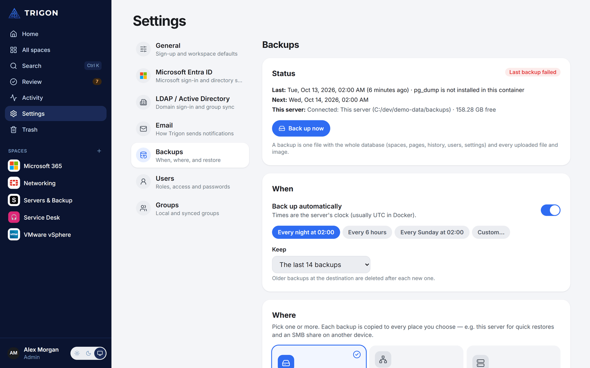<br><b>Backups</b> — schedule, several destinations, one-click restore.</td>
  </tr>
  <tr>
    <td>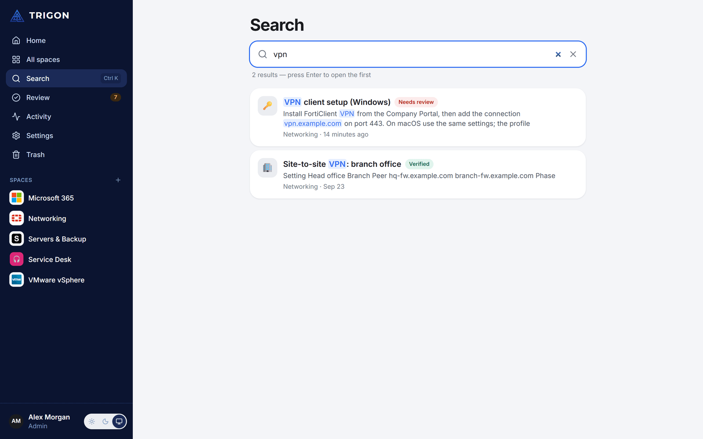<br><b>Search</b> — as you type, across pages and the text inside files (PDF, Office, scans via OCR).</td>
    <td>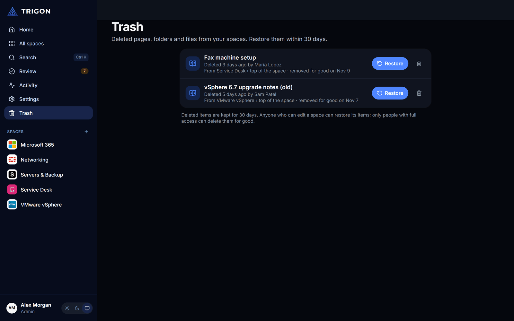<br><b>Trash</b> — restore deleted pages, folders and files for 30 days.</td>
  </tr>
</table>

## On your phone

<p align="center">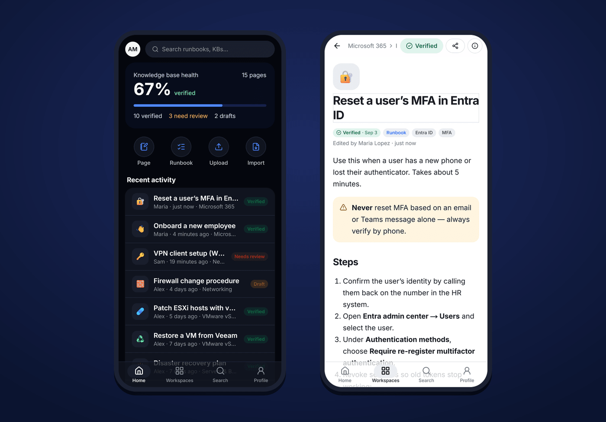</p>
<p align="center"><sub>Install it from the browser on iOS and Android — no app store, full screen, with an offline fallback.</sub></p>

## Everything else

- **Sign in** with email/password, **Microsoft Entra ID** (OIDC) or **LDAP / Active Directory** — all mapped onto one user.
- **Directory sync** pulls users, security groups and memberships from Microsoft Graph and LDAP on a schedule.
- **Spaces → folders → pages / files**, with **inherited permissions** granted to users, synced groups or everyone, and a share dialog showing where access comes from.
- **Real-time editor** (Tiptap + Yjs) with a **"/" command menu**, a **web clipper** that cleans pasted web pages and re-hosts their images, and **YouTube / Vimeo / Loom / link-card embeds**.
- **In-app viewers** for **PDF**, **Word**, **Excel** and **PowerPoint**; **editable text & code files** (YAML, JSON, PowerShell, Bash, Python, configs…).
- **Email notifications** through any SMTP server or Microsoft 365 — shared with you, review requests, account changes, and a daily or weekly digest of pages to review — each person chooses which.
- **Import** Markdown / HTML files or whole folders; **export** spaces, folders and pages as Markdown or HTML.
- **Automatic updates** (optional): a scoped Watchtower keeps the Trigon containers current — and never touches anything else on the host.

## Repository layout

```
apps/
  api/        NestJS 11 · Drizzle ORM · Passport (local, LDAP, JWT) · MSAL (Entra) · Hocuspocus (Yjs)
  web/        Next.js 16 (App Router) · Tailwind CSS 4 · Serwist (service worker) · Tiptap 3
packages/
  shared/     Types and helpers used by both (permission levels, embed URL matching, …)
docker/       Postgres init script (enables pgvector)
docker-compose.yml   Postgres 17 + pgvector, Redis 7, api, web (prebuilt images)
docker-compose.build.yml  Optional: build api/web from source
```

## Branches

| Branch | Purpose |
| ------ | ------- |
| `main` | Stable — only code that has been tested and works. This is what everyone runs. |
| `dev`  | Active development — may be broken. Work happens here, then merges into `main`. |

Typical flow: feature branch off `dev` → pull request into `dev` → test on the NAS with the `:dev` images → pull request `dev → main`.
See **[CONTRIBUTING.md](CONTRIBUTING.md)** for setting up a development machine.

## Running it

### Option A — Synology / any Docker host, prebuilt images (recommended)

GitHub Actions publishes ready-to-run images to `ghcr.io/nicklnn/trigon-api` and `ghcr.io/nicklnn/trigon-web`
(`:latest` from `main`, `:dev` from `dev`). Follow **[deploy/synology/README.md](deploy/synology/README.md)**.

### Option A2 — build the images yourself

```bash
docker compose -f docker-compose.yml -f docker-compose.build.yml up -d --build
```

### Option B — local development

Requires Node 22+ and Docker (for Postgres + Redis).

```bash
cp .env.example .env        # set JWT_ACCESS_SECRET; defaults point at localhost
npm install
docker compose up -d postgres redis
npm run db:migrate
npm run dev                 # api on :4000 (+ ws :4001), web on :3000
```

> **Windows + network share:** npm workspaces need directory junctions, which Windows cannot create on an
> SMB share. Run `npm install` / `npm run dev` from a clone on a local disk (e.g. `C:\dev\trigon`);
> the copy on the NAS share is for Docker builds.

### Useful scripts

| Command | What it does |
| ------- | ------------ |
| `npm run dev` | API + web in watch mode |
| `npm run typecheck` | Type-check every workspace |
| `npm test` | Unit tests (code detection, embed matching, …) |
| `npm run db:generate` | Create a migration after editing `apps/api/src/db/schema.ts` |
| `npm run db:migrate` | Apply migrations |
| `npm run icons -w @trigon/web` | Rebuild logo, app icons and favicon from `apps/web/brand-src/trigon-logo-original.png` |

## File support

| Type | In Trigon |
| ---- | --------- |
| Pages | Real-time collaborative editing |
| Text & code (.txt, .md, .yaml, .json, .ps1, .sh, .py, .conf, …) | **Editable** in the built-in code editor |
| PDF | Viewer with search, zoom, page jump |
| Word (.docx), Excel (.xlsx), PowerPoint (.pptx) | **Read-only** preview in the browser — download to edit |
| Visio (.vsdx) | Download only (no browser preview yet) |
| Images | Inline preview |
| Anything else | Stored and downloadable |

**Search inside files.** The text of uploaded PDFs, Word, Excel, PowerPoint, OpenDocument and text files
is indexed in the background, so search finds what is inside them. Scanned PDFs and images are read with
OCR (Tesseract, English + Greek built in — [add more languages](docs/ocr-languages.md)). It runs one file
at a time at low priority and stores only the text, in the database.

> **Why Office files are read-only:** in-browser editing of Word/Excel/PowerPoint needs an office
> server such as OnlyOffice Docs or Collabora, which wants 2–4 GB of RAM on its own. Trigon stays
> lightweight on the NAS by previewing these files instead. A self-hosted office server can be added
> later as an optional container if editing becomes a requirement.

## Architecture notes

**Identity.** `users` is the single identity; `accounts` holds one row per sign-in method
(`local` with an argon2id hash, `entra` keyed by object id, `ldap` keyed by objectGUID). Directory
identities link to an existing user by e-mail; local self-sign-up never attaches to a directory user.

**Sessions.** A 15-minute JWT access token and an opaque, rotating refresh token, both in `httpOnly`
cookies. Reusing a rotated refresh token revokes its whole family. The browser only ever talks to the
web origin — `/api/*` is proxied to the API — so cookies stay first-party.

**Permissions.** `permissions` rows grant `view < comment < edit < manage` on a space or document to a
user, a group or everyone. Effective access is the strongest grant on the document, any ancestor
folder, or the space. Synced Entra/LDAP groups are ordinary groups, so access follows the directory.

**Collaboration.** Each page is a Yjs document served by Hocuspocus (document name = page id). Clients
authenticate with a 10-minute token from `GET /auth/collab-token`; viewers connect read-only. The server
stores the Yjs state plus a ProseMirror JSON snapshot and plain text (used by full-text search).
Redis lets several API replicas share live documents.

**Editor extensions** (`apps/web/src/components/editor/extensions`):
- `auto-code` — classifies pasted plain text (structural heuristics + highlight.js relevance) and wraps code in a
  highlighted code block; honours VS Code's clipboard language; auto-labels unlabelled code blocks as you type.
- `web-clipper` — sanitises pasted HTML (DOMPurify), rebuilds highlighted code samples as clean `<pre><code>`,
  resolves relative URLs, and copies external images into Trigon storage via `POST /files/attachments/import`.
- `embed` — YouTube / Vimeo / Loom players and Open-Graph link cards (`GET /embeds/unfurl`, SSRF-guarded).

**Search.** Full-text search uses a Postgres GIN index over title + body, with prefix matching as you type
and title matches ranked first; results only include what the person may open. Text is folded by
`trigon_fold()` (case, accents and Greek final sigma ignored, so `αθηνα` finds `ΑΘΉΝΑΣ`), and a trigram
fallback catches typos in titles. Uploaded files get their text from `TextIndexService` (`apps/api/src/search`):
poppler for PDFs, a small built-in zip/XML reader for Office files, Tesseract for scans — no AI, no extra services.

## Roadmap (next)

- Comments on pages and paragraphs (they will plug into review requests and notifications)
- S3-compatible storage driver
